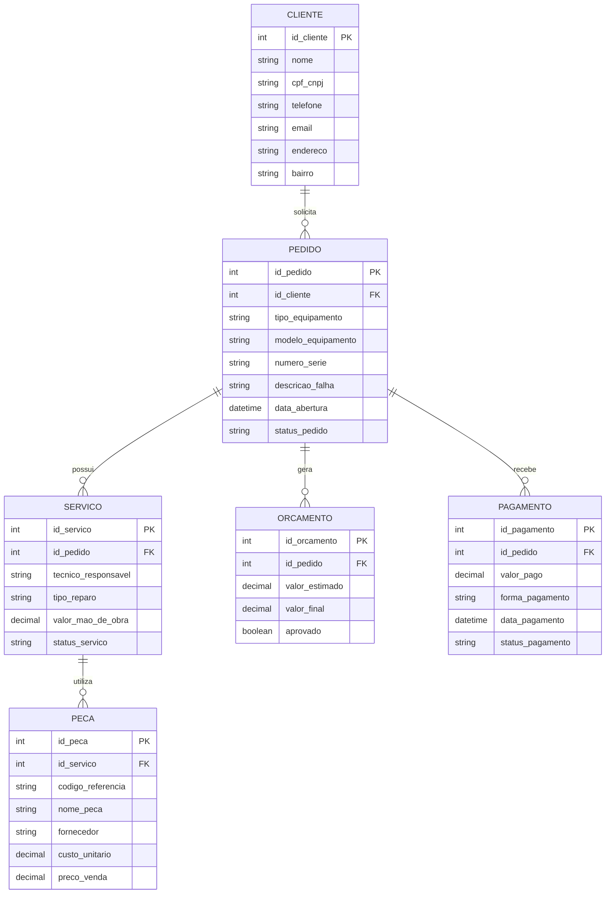

# Projeto Integrador I - Nova DPS Informática
## Documentação Acadêmica Principal

**Curso:** Tecnologia em Banco de Dados / Análise e Desenvolvimento de Sistemas  
**Instituição:** FATEC Ipiranga  
**Versão:** 2.0  

---

## 1. Introdução
O presente projeto tem por finalidade desenvolver uma solução integrada de software e análise de dados para a assistência técnica especializada **Nova DPS Informática**, localizada em São Paulo. A empresa realiza diagnóstico e reparo avançado de componentes eletrônicos (notebooks, desktops, servidores e placas-mãe).

O sistema substitui o controle manual fragmentado por uma aplicação desktop de alta performance desenvolvida em **Python (PySide6)** integrada a um **Banco de Dados Relacional** com consistência transacional e um painel executivo para suporte à tomada de decisão gerencial.

---

## 2. Posicionamento Estratégico

### 2.1 Descrição do Problema
| Item | Descrição |
|---|---|
| **O problema** | Dificuldade no controle de prazos de manutenção, ausência de rastreabilidade de peças alocadas e falta de visibilidade do balanço financeiro por chamado. |
| **Afeta** | Técnicos de bancada, atendimento ao cliente, gerência e os próprios clientes da assistência técnica. |
| **Cujo impacto é** | Atraso na entrega dos reparos, perda de margem em peças substituídas, retrabalho e insatisfação dos clientes. |
| **Uma boa solução seria** | Um sistema desktop moderno com controle de fluxo (CRUD completo), fila de serviços ordenada por tempo de espera, histórico e rastreio de componentes por ordem de serviço e painel executivo com métricas financeiras e operacionais. |

### 2.2 Estrutura Organizacional
A Nova DPS Informática adota uma estrutura **Funcional / Linha-Staff**:
- **Diretoria / Gestão:** Gestão financeira, comercial e tomada de decisão estratégica;
- **Atendimento e Recepção (Linha):** Abertura de chamados, contato via WhatsApp e faturamento;
- **Laboratório Técnico (Linha):** Diagnóstico em bancada, microeletrônica, soldagem BGA e troca de peças;
- **Compras e Estoque (Staff):** Aquisição e conferência de componentes junto a fornecedores especializados.

### 2.3 Matriz SWOT (FOFA)
- **Forças (Strengths):** Domínio técnico em reparo avançado de placas (reballing BGA); alta taxa de sucesso nos reparos; clientela fidelizada.
- **Oportunidades (Opportunities):** Mercado aquecido de manutenção devido ao alto custo de equipamentos novos; convênios de manutenção corporativa para pequenas empresas.
- **Fraquezas (Weaknesses):** Controle descentralizado de ordens de serviço; ausência de relatórios em tempo real; dependência de processos manuais.
- **Ameaças (Threats):** Escassez ou aumento do preço de semicondutores importados; concorrência informal desqualificada.

---

## 3. Requisitos do Sistema

### 3.1 Requisitos Funcionais (RF)
- **RF-01:** Gestão completa (CRUD) de Clientes com validação de dados de contato.
- **RF-02:** Gestão completa (CRUD) de Pedidos (chamados de entrada de equipamentos).
- **RF-03:** Gestão técnica (CRUD) de Serviços com atribuição de técnicos e status de reparo.
- **RF-04:** Gestão de Orçamentos (estimado vs aprovado/final).
- **RF-05:** Gestão de Peças com rastreabilidade por serviço e fornecedor.
- **RF-06:** Controle Financeiro e Pagamentos com múltiplas formas de quitação.
- **RF-07:** Fila operacional de serviços pendentes ordenada por tempo de espera.
- **RF-08:** Balanço financeiro analítico (valor orçado vs valor pago vs saldo devedor).
- **RF-09:** Exportação de dados operacionais e consolidados para integração com Power BI.
- **RF-10:** Dashboard executivo interativo no próprio sistema desktop.

---

## 4. Modelagem do Banco de Dados Relacional

