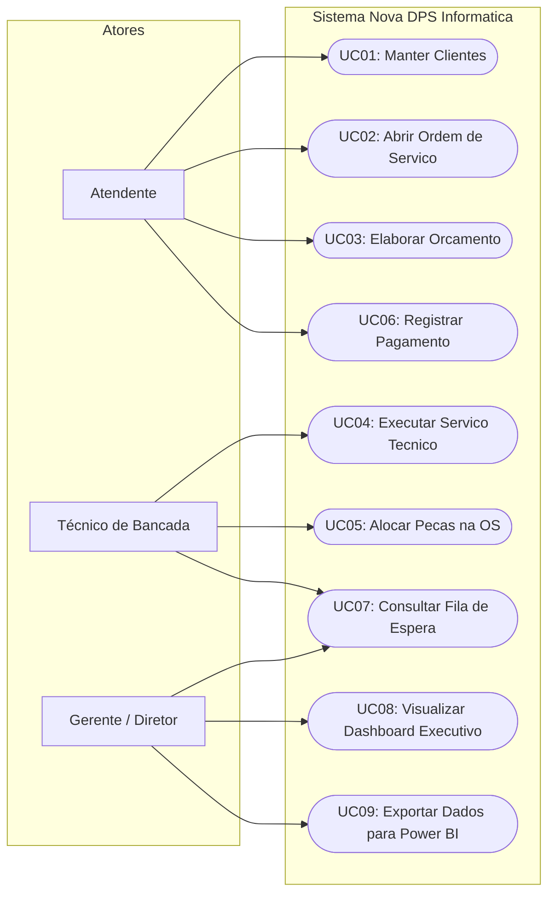

# Engenharia de Software & Casos de Uso
## Nova DPS Informática - Projeto Integrador I

Este documento detalha os atores envolvidos e as interações de negócio através do **Diagrama de Casos de Uso (UML)** e da especificação dos fluxos principais.

---

## 1. Atores do Sistema

- **Atendente / Recepcionista:** Responsável pelo primeiro contato com o cliente, abertura de ordens de serviço (pedidos), emissão de orçamentos e registro de pagamentos.
- **Técnico de Bancada:** Responsável pelo diagnóstico do equipamento, realização dos procedimentos técnicos, alocação de peças do estoque e finalização dos serviços.
- **Gerente / Administrador:** Responsável pela análise dos indicadores de desempenho no painel executivo, acompanhamento de metas financeiras e relatórios operacionais.

---

## 2. Diagrama de Casos de Uso (UML)

---

## 3. Especificação Sumária dos Casos de Uso Principais

### UC02 - Abrir Ordem de Serviço
- **Ator Principal:** Atendente.
- **Pré-condição:** Cliente deve estar previamente cadastrado ou ser registrado no ato.
- **Fluxo Principal:**
  1. O atendente seleciona o cliente solicitante.
  2. Informa os dados do equipamento (tipo, marca, modelo e número de série).
  3. Descreve detalhadamente a falha informada pelo cliente e acessórios deixados.
  4. O sistema grava o pedido com status `Aberto` e gera número de OS sequencial.
  5. É gerado o comprovante de entrada para o cliente.

### UC04 - Executar Serviço Técnico
- **Ator Principal:** Técnico de Bancada.
- **Pré-condição:** Pedido em status `Aberto` ou `Em Análise`.
- **Fluxo Principal:**
  1. O técnico consulta a fila de serviços ordenada por data de entrada mais antiga.
  2. Assume o chamado atribuindo seu nome como responsável.
  3. Preenche o laudo e diagnóstico técnico.
  4. Informa o valor da mão de obra necessária e define o status como `Em Andamento`.

### UC05 - Alocar Peças na OS
- **Ator Principal:** Técnico de Bancada.
- **Fluxo Principal:**
  1. Durante o reparo, o técnico pesquisa o componente no estoque.
  2. Seleciona a quantidade e vincula o item ao `id_servico`.
  3. O sistema calcula automaticamente o preço de venda e margem de lucro.
  4. O custo é incorporado ao orçamento final do pedido.

### UC08 - Visualizar Dashboard Executivo
- **Ator Principal:** Gerente.
- **Fluxo Principal:**
  1. O gerente acessa a tela inicial do sistema.
  2. O sistema executa as consultas analíticas e exibe os KPIs de faturamento, chamados ativos e ticket médio.
  3. Os gráficos e a tabela de fila de espera são atualizados em tempo real.
